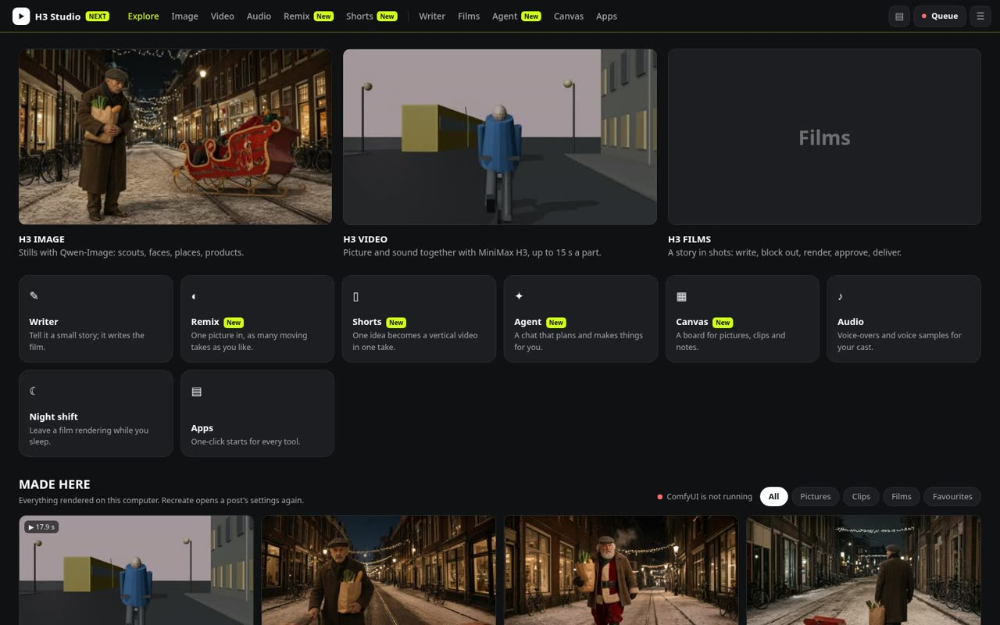
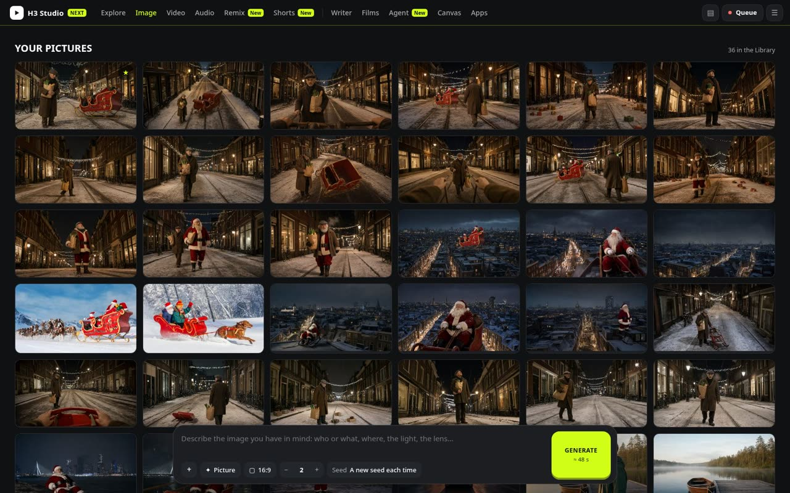
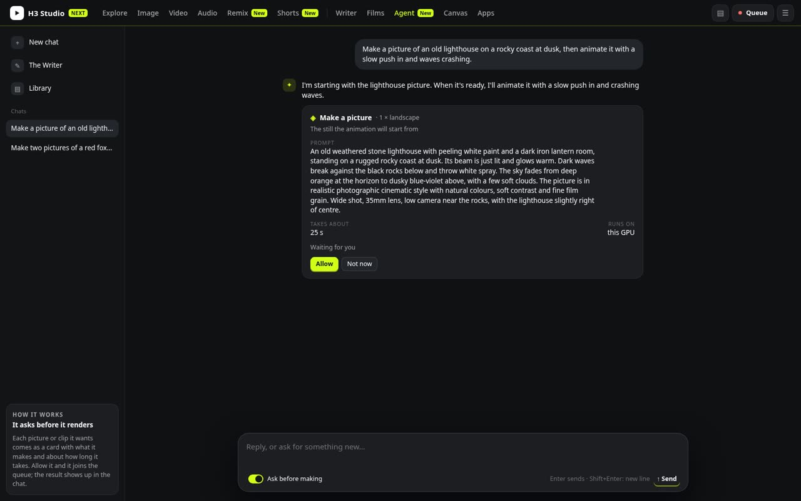

# H3 Studio Next

A film and media studio on your own computer, on top of ComfyUI. Pictures with Qwen-Image 2.1, video with sound with
MiniMax H3, whole films shot by shot, all rendered by the ComfyUI on your machine.

This is [H3 Studio](https://github.com/fuzzballb/comfyui-h3-studio) with a new front end in the style of
[Parallax](https://github.com/nickvasilescu/parallax) (an open-source studio that runs on paid cloud models), and with
some of Parallax's ideas brought home: a feed with Recreate, Remix, Shorts, an agent chat with approval cards, a
canvas and a fuller Library. The backend (films, blockouts, the Writer, the checks and the gate) is H3 Studio's.



| | |
|---|---|
|  |  |

**[What is in it](#what-is-in-it) · [Install](#install) · [What came from Parallax](#what-came-from-parallax) ·
[What it does not do](#what-it-does-not-do)** · the [tour with pictures](docs/guide.md)

## What is in it

| Page | What it does |
|---|---|
| **Explore** | The home page: the three studios, the newer tools, your films in progress and a feed of everything made here. Hover a post to see its prompt; **Recreate** opens the page it was made on with its settings filled in. ☆ makes it a favourite. |
| **Image** | A floating prompt bar with chips: what to make (picture, face, place, edit, other angles, outfit sheet, prop sheet), size, takes, seed. **+** attaches pictures to edit. The Generate button shows about how long it takes on this machine. |
| **Video** | The same bar for MiniMax H3: look, camera move, framing, size, length, turbo, the exact spoken lines, sound, place. **+** starts from a first frame (and a last). **Full form** has everything else: people with faces, outfits and voices, reference pictures, blockouts, long takes, several looks. |
| **Audio** | Words spoken by ChatterBox in a voice from the TTS Audio Suite; voice samples for characters. |
| **Remix** | One picture plus a direction gives a moving take; as many takes as you like. Nine directions to start from (slow push in, half orbit, comes to life, rain starts…) or your own words. Standard (turbo) or Pro (all steps). |
| **Shorts** | One idea becomes a vertical video in one continuous take: Claude Code splits it into 2 to 5 parts, you change any of them, and the parts render in order, each continuing the one before. |
| **Writer** | Tell a small story; it asks a few questions and writes the film (cast, places, shots in scenes, the exact lines, blockouts). |
| **Films** | The seven steps of a film from H3 Studio: bible, cast and places, shots, blockout, storyboard, roll camera (with the gate and the checks), deliver. |
| **Agent** | A chat that plans and makes things: pictures, edits, animations, clips, or a whole film through the Writer. Each thing it wants to render is a card with the prompt and about how long it takes; nothing renders until you press **Allow** (switch "Ask before making" off to let it go ahead). Results show up in the chat. |
| **Canvas** | Open boards for pictures, clips and notes: drag, resize, zoom, drop files on it. Boards are kept by the studio. |
| **Library** | Kinds, favourites, uploads and folders on the left; search, sort, and a selection bar: favourite, move to a folder, put on a board, add to the timeline, cut to a song, delete (to a trash that can be undone). |
| More (☰) | Edit a picture, night shift, cast library, timeline, sound, Machine, Learn, and ComfyUI's terminal output. |

The queue is a drawer on the right (the **Queue** button in the top bar); it shows what is rendering and the takes
waiting at the gate.

Only text ever leaves the computer, and only for the Writer, the Agent and the Shorts planner: they run the Claude Code
program that is signed in on this computer (`claude -p`, no tools), so they use that subscription. Pictures, clips and
sound are made by your ComfyUI and stay on your disk.

## Install

You need ComfyUI with MiniMax H3 and Qwen-Image 2.1 working, ffmpeg, and a GPU that runs them. It was built on Linux
with an RTX 3090 (24 GB) and 62 GB RAM.

1. **Node packs and models**: as for H3 Studio. Follow [Installation](docs/long-video.md#installation) in the
   long-video manual. The long-video nodes themselves come from
   [comfyui-h3-long-video](https://github.com/fuzzballb/comfyui-h3-long-video) or
   [comfyui-h3-studio](https://github.com/fuzzballb/comfyui-h3-studio) in `custom_nodes`; this repo has no ComfyUI
   nodes of its own. Optional: TTS Audio Suite, `openai-whisper` in ComfyUI's Python, Blender for blockouts,
   Claude Code for the Writer, the Agent and Shorts.
2. **This repo**, anywhere; inside the ComfyUI folder is easiest:

   ```bash
   cd ComfyUI
   git clone https://github.com/fuzzballb/h3-studio-next
   cd h3-studio-next
   ./run_studio.sh            # uses ComfyUI's own Python; nothing else is installed
   ```

   Open **http://127.0.0.1:8191**. ComfyUI has to be running; **☰ → Machine** shows what is ready.
   Elsewhere, point it at ComfyUI with `COMFYUI_DIR=/path/to/ComfyUI ./run_studio.sh`.

Its data lives in ComfyUI's output folder, in `output/studio_next/`, apart from H3 Studio's `output/studio/`. To work
on H3 Studio's films instead, stop H3 Studio and start this one with `STUDIO_HOME=/path/to/ComfyUI/output/studio`: the
files are the same format. Two servers never share one data folder (the second one refuses to start).

It listens on this computer only and has no sign-in; `--host` opens it to your network, where anyone who reaches it can
use it.

## What came from Parallax

Parallax is MIT-licensed. From it came the look (the dark palette with a lime accent, the top bar, the floating
composer with chips, the big studio cards and feature tiles, the side-form studios, the agent chat with approval
cards) and these features, rebuilt here in plain JavaScript on H3 Studio's own API:

| Parallax | Here |
|---|---|
| Explore feed with Recreate | A feed of your own renders; every picture and clip keeps the request it was made with |
| Price on the Generate button | About how long the job takes on this machine, from its own past renders |
| Remix | Picture to motion with directions, on MiniMax H3 (first frame, optional last frame) |
| Shorts | One idea, planned by Claude Code, rendered as parts of one continuous vertical take |
| Supercomputer (agent chat) | The Agent, with "Ask before making" and a card for each render |
| Canvas | Boards kept by the studio, not only in the browser |
| Library with folders and favourites | The same, plus H3 Studio's trash, checks and actions |

Left out on purpose: accounts, credits and payments, the community feed, contests, ads campaigns, the public API keys
and webhooks (this is one person's studio on one computer), and the cloud model gateway (everything renders locally).
No Parallax code, wording, logos or pictures are used.

## What it does not do

- **No music is made here**, and no lip-synced avatars from a still alone: the video model makes the voice and the
  lips together from the spoken lines.
- **The Agent cannot run anything but the studio's own tools**, and Claude Code runs without tools, files or web.
  It sees the names, kinds and prompts of your newest 30 Library files, the names of your films and the chat.
- **Canvas boards hold Library files and notes**; they are not an editor.
- **Tested on one machine**: Linux, an RTX 3090, ComfyUI 0.42. Windows and macOS are untried.

Everything else H3 Studio does not do still applies: see its README.

## Tests

```bash
~/ComfyUI/venv/bin/python -m unittest discover -s tests -t .
```

Runs without ComfyUI and without Claude (stand-ins for both). `tests/test_next.py` covers what this repo adds.

## Credits

The models and node packs this stands on, H3 Studio, and Parallax for the look and the ideas: [CREDITS.md](CREDITS.md).
