# A tour with pictures

Every page of H3 Studio Next, in the order you will probably use them. The pictures were taken in the studio itself;
the films and clips in them were made with it. For the film steps in depth (bible, cast, shots, blockout, storyboard,
roll camera, deliver), see the **Tutorial** tab.

## Explore

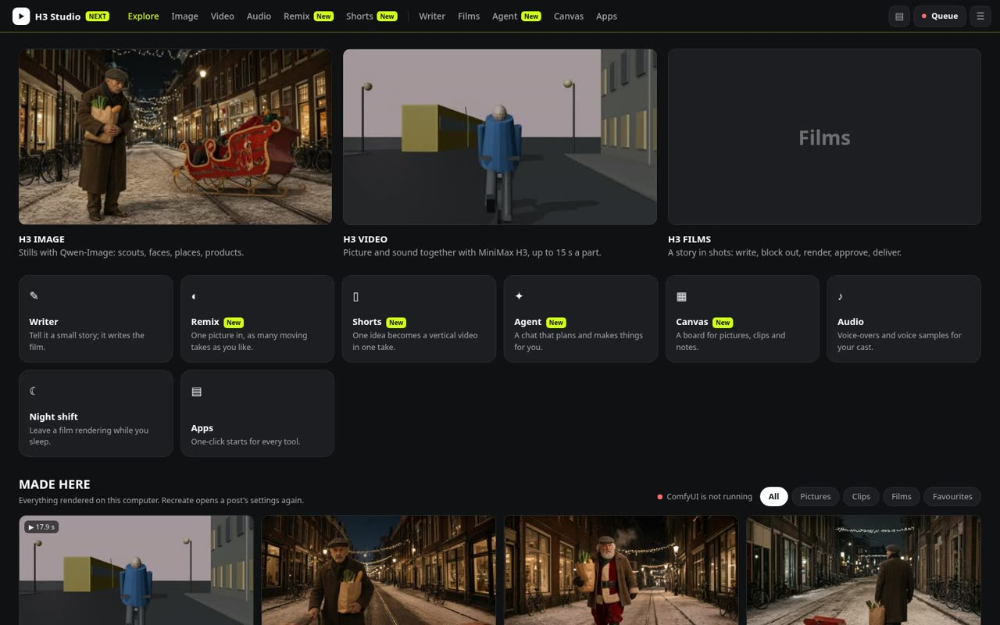

The home page. The three big cards open the studios for pictures, video and films. The tiles below are the other
tools. Further down, **Made here** is a feed of every picture and clip on this computer. Point at a post to play it
and read its prompt.

- **Recreate** opens the page the post was made on, with the same prompt, size, takes and seed.
- **Remix** uses a picture as the first frame of a moving take.
- **☆** makes it a favourite.

The dot by the filters says whether ComfyUI is running. **☰** in the top right holds the rest of the rooms.

## Image

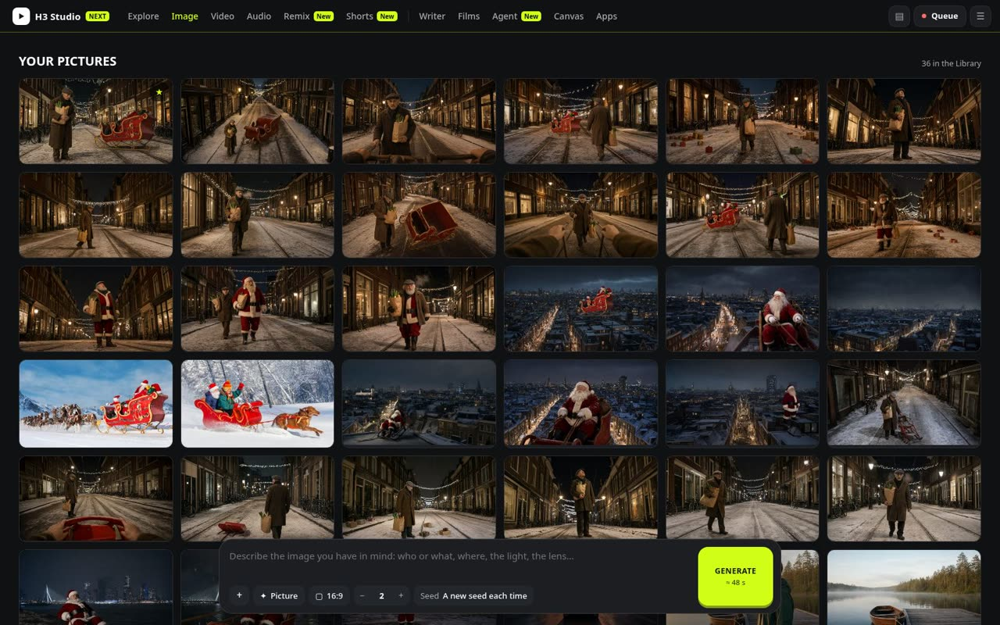

Type what you want in the bar at the bottom. The chips set what to make, the size, the number of takes and the seed:

- **Picture**: a plain picture.
- **Face**: a face for a character.
- **Place**: an empty place, for a location.
- **Edit**: changes attached pictures in words.
- **Other angles**: the same subject seen from elsewhere.
- **Outfit sheet** and **Prop sheet**: views of one thing on white, for reference.

**+** attaches pictures from the Library. The Generate button says about how long it takes on this machine, from the
renders it has done before. Results appear in the grid while they render.

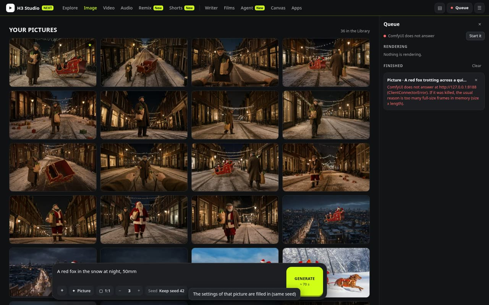

## Video

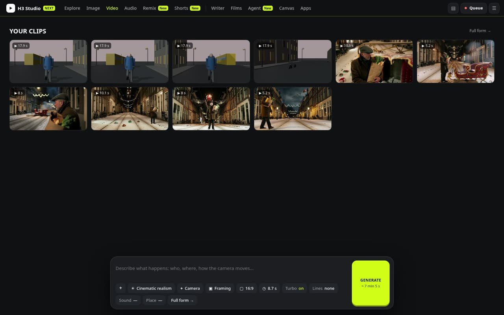

The same bar for MiniMax H3. Describe what happens; the chips add a look, a camera move, a framing, a size and a
length. **Lines** are the exact words people say. Every spoken word must be a line, or the model mumbles. **Sound** is
what else is heard, and **Place** is where it happens. **+** starts the clip from a first frame (and optionally a last one).

**Full form** opens everything else: people with faces, outfits and voice samples, reference pictures, a blockout to
follow, a long take that continues a clip, or one shot in several looks.

## Blockout

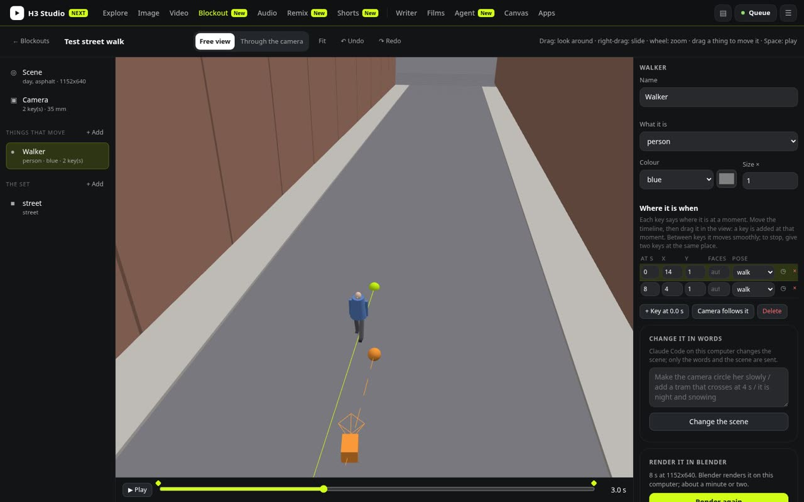

For shots that words cannot hold: a camera that circles or follows, a car that stops and turns, people placed
exactly. Describe the shot and Claude Code builds the scene, or start from a street and build it yourself.

- **Left:** the scene, the camera, the things that move and the set. **+ Add** puts a new one in the middle of the view.
- **The 3D view:** drag to look around, right-drag to slide, the wheel to zoom. Drag a thing to move it: at the
  moment on the timeline it gets a key there. Between keys it moves smoothly (the white line is its path; the dashed
  orange line is the camera's).
- **Through the camera** shows exactly what the video will frame, at the size of the video.
- **Cars** come as a saloon, coupe, sports car, SUV or pickup, with see-through windows. Pick a **Driver** for a car
  and someone sits at the wheel, seen through the windows. Blender and the 3D view build them from the same
  `studio/static/car_shapes.json` (made by `studio/blender/make_car_shapes.py`).
- **The camera:** look around in the free view until it shows the shot, then **Set the camera to my view**. Each key
  can follow a thing by name, and **Cut here** jumps to a new angle.
- **Change it in words** asks Claude Code to change the scene ("make the camera circle her"). Ctrl+Z undoes anything.
- **Edit in Blender** opens the scene in Blender's own window. Every set piece and moving thing is one object, and its
  keys are keyframes. The camera is "Camera" and looks at "Camera aim". Move, turn and scale things, or insert keys (I)
  at other frames. Then press **Send to H3 Studio** in Blender's sidebar (N → H3 Studio), or save with Ctrl+S, and the
  studio's view follows. Poses, kinds and colours are changed in the studio. Plain meshes you add in Blender come back
  as boxes.
- **Render the blockout** makes the grey video in Blender, and **Use in a video** opens the Video form with it.

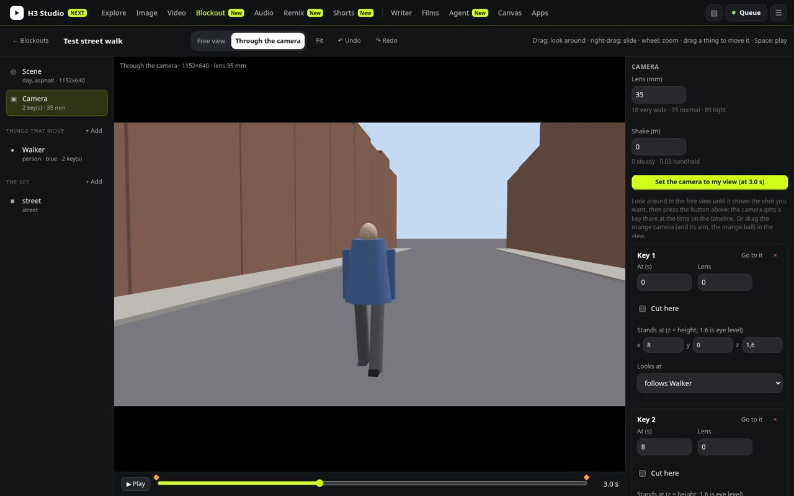

## Remix

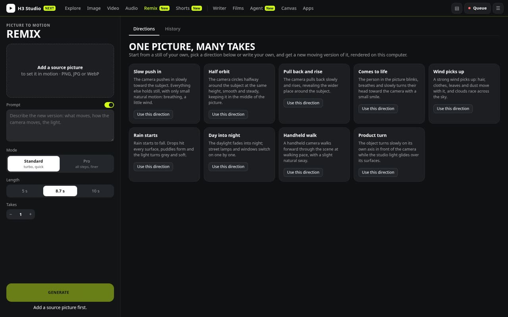

Drop a picture on the left (and an end picture if you want one). Pick a direction or write your own, choose
**Standard** (turbo, quick) or **Pro** (all steps), a length and the number of takes. The takes land under **History**.

## Shorts

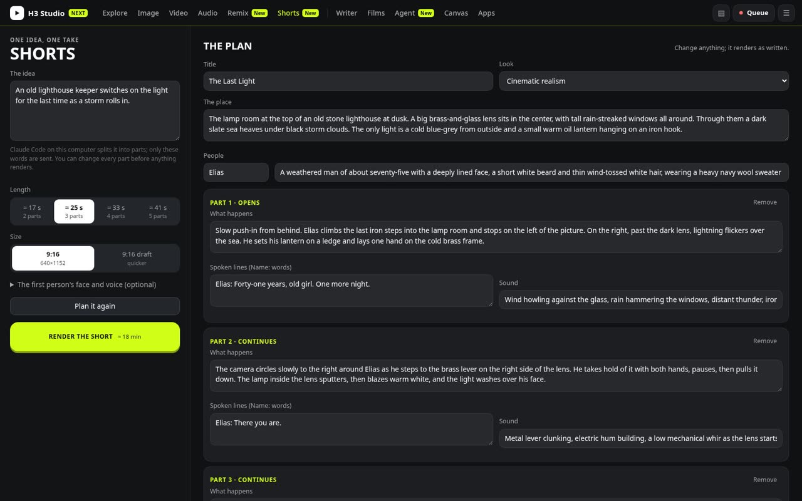

Write an idea and pick a length. **Plan it** asks Claude Code on this computer to split it into parts. Only the words
are sent. Change anything in the plan: the title, look, place, people, what happens in each part, the spoken lines
and the sound. **Render the short** renders the parts in order. Each part continues the one before, so the result is
one vertical take with no cuts.

## Agent

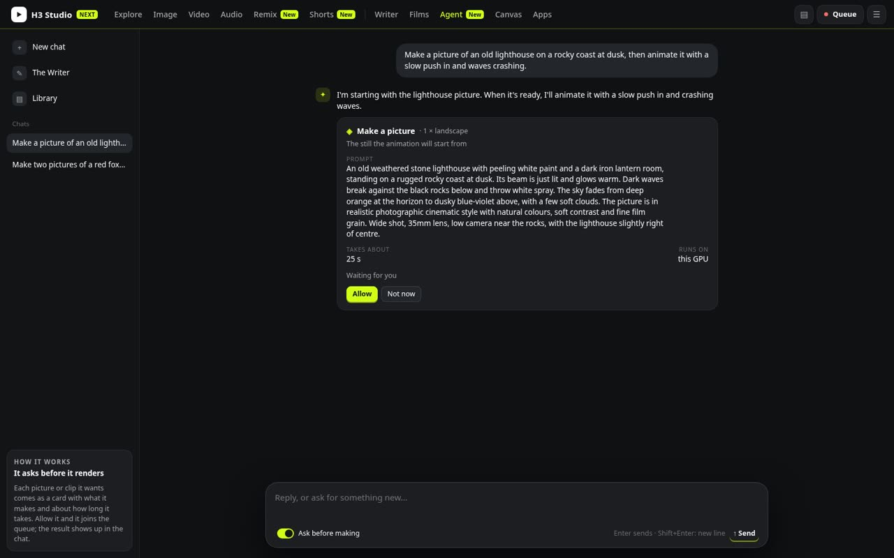

Ask for what you want in plain words. The agent answers, and each picture, edit, animation or clip it wants to make
comes as a card with the prompt and about how long it takes. Nothing renders until you press **Allow**; **Not now**
leaves it. Switch **Ask before making** off to let it go ahead on its own. Results show up in the card. When a card
fails (ComfyUI was not running, say), **Try again** runs it once more. To make a whole film, ask for one: the agent
hands the story to the Writer.

## Canvas

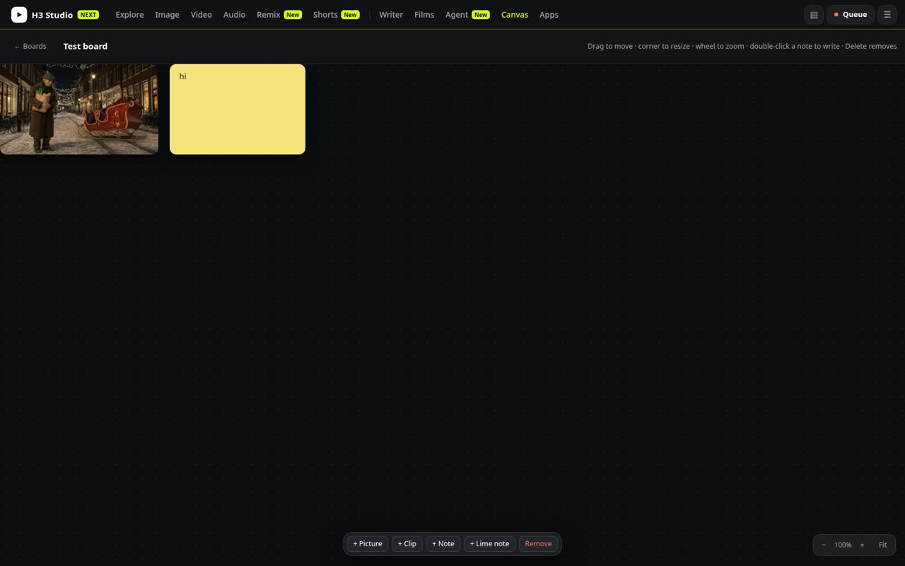

Boards for laying things out: a mood board, a storyboard wall, a cast line-up. Use **+ Picture**, **+ Clip** or
**+ Note**, or drop files on the board.

- Drag an item to move it, or its corner to resize it.
- Drag the background to pan, and use the wheel to zoom. **Fit** shows everything.
- Double-click a note to write in it, or a picture to open it.

Boards are kept by the studio, so they are still there in another browser.

## Library

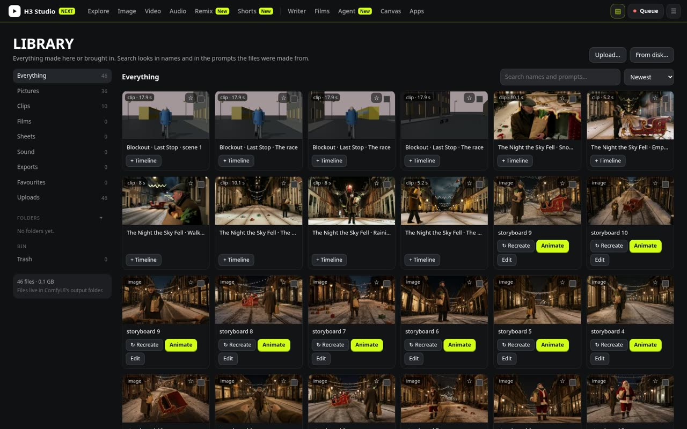

Everything made or brought in. The side list filters by kind, favourites, uploads, what came from where, and your
folders (**+** makes one). Search covers names and prompts. Tick tiles to select them; the bar on top can:

- favourite them;
- move them to a folder;
- put them on a board;
- add them to the timeline, or cut them to a song;
- delete them, into a trash that can be undone.

Open a file for its actions: upscale, captions, location sound, a frame as a picture, ProRes, and so on.

## The rest

The top bar holds **Writer** and **Films** (the film steps from H3 Studio) and **Apps** (one-click starts for 43 kinds
of shots). **☰** has Edit a picture, the night shift, the cast library, the timeline, sound, Machine (what can run on
this computer), this Learn page, and **Show ComfyUI's output**. The **Queue** button opens the drawer with what is
rendering and the takes waiting at the gate.
